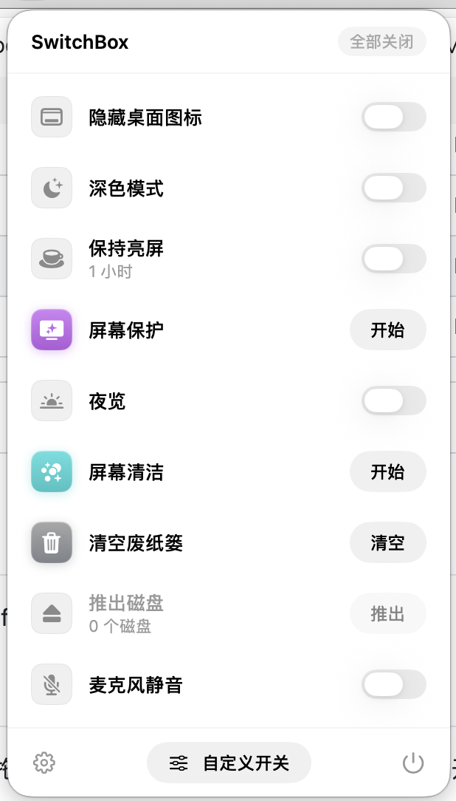
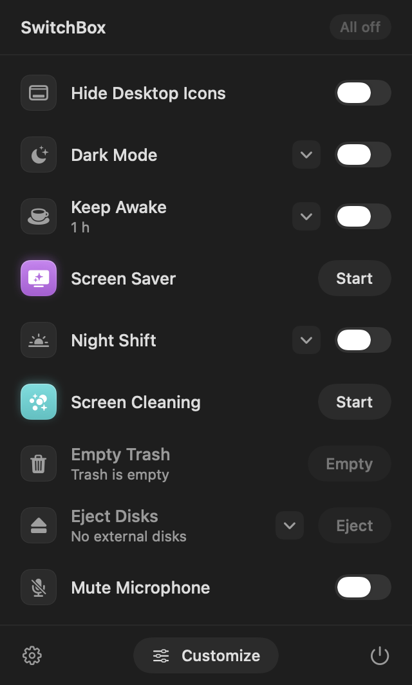
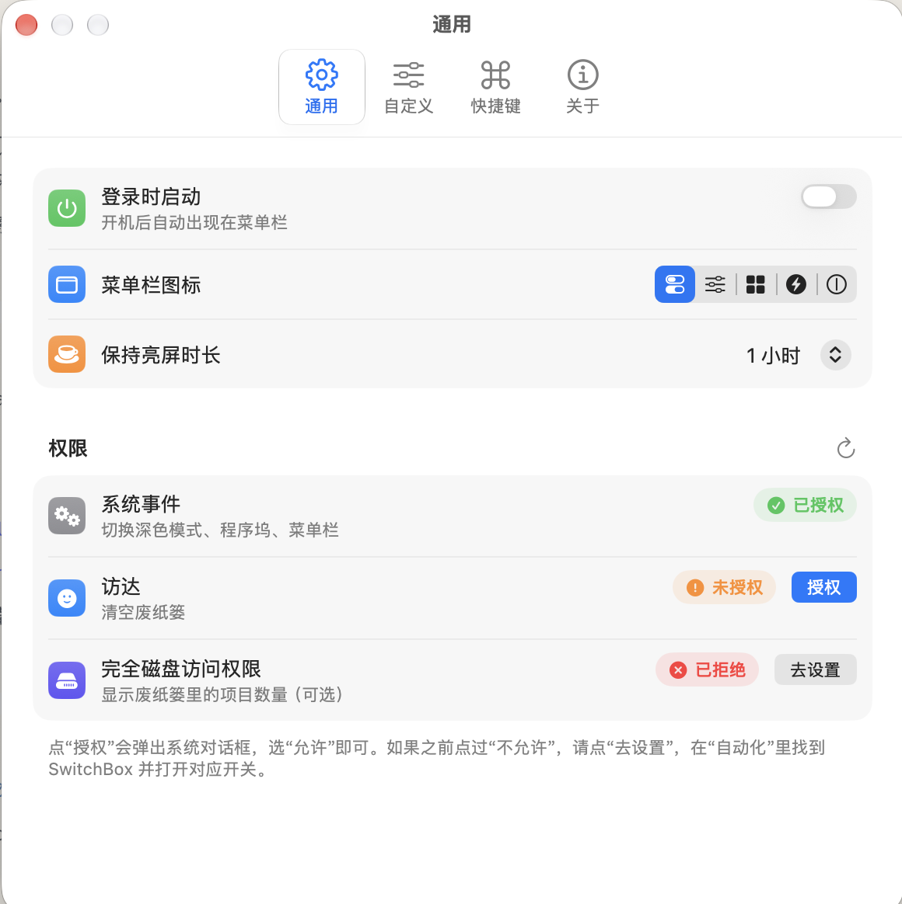
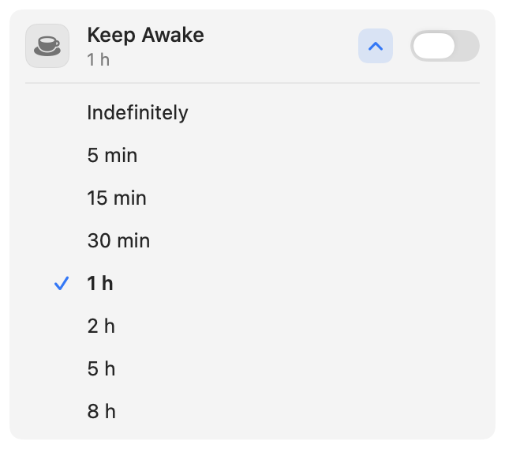
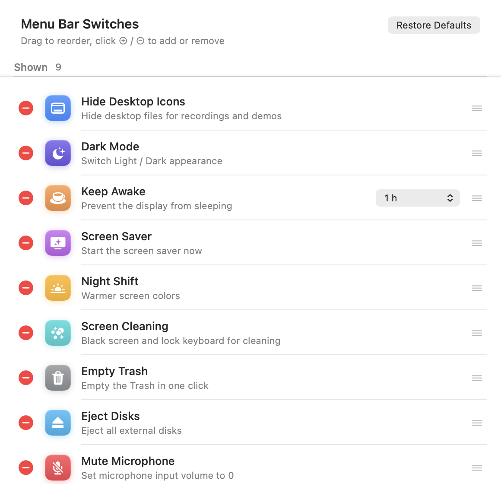
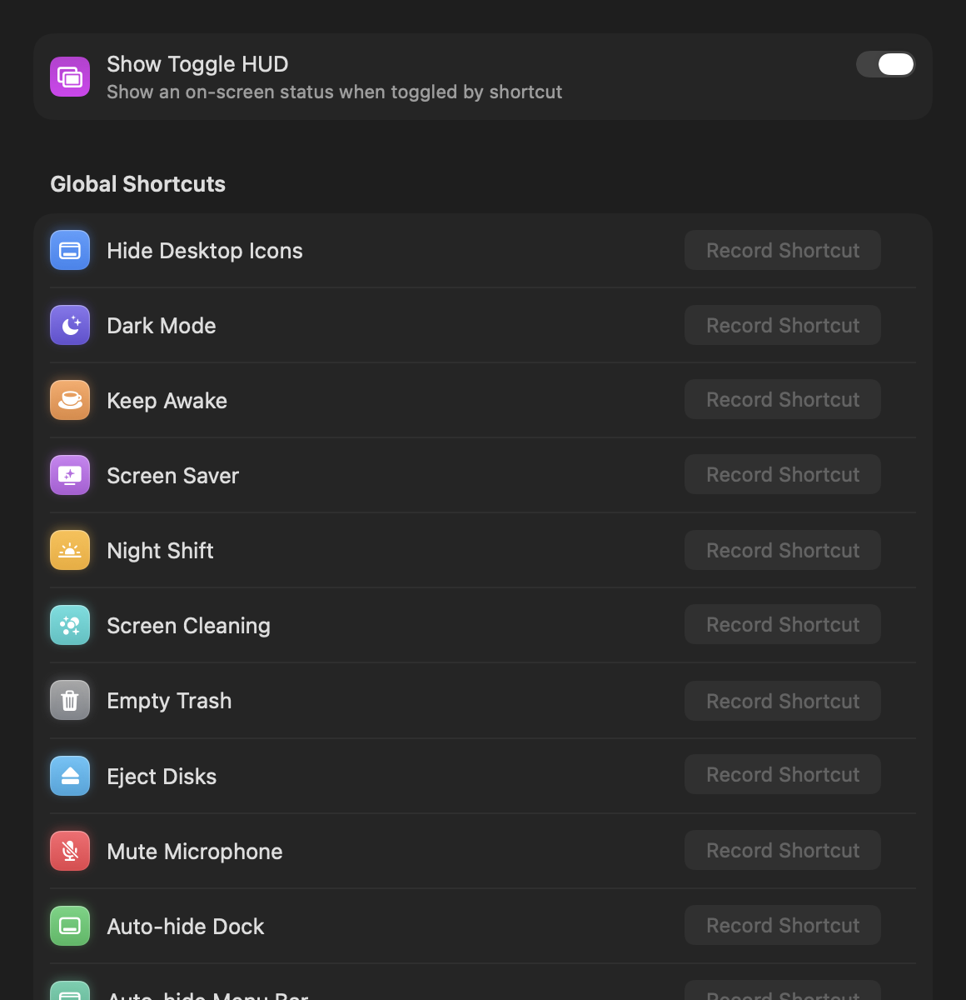

<p align="center">
  
</p>

<h1 align="center">SwitchBox</h1>

<p align="center">
  <b>All your everyday macOS toggles, one click away in the menu bar.</b><br>
  Native SwiftUI · Lightweight · No tracking
</p>

<p align="center">
  
  
  
  <a href="https://github.com/245678000000/SwitchBox/releases/latest"></a>
</p>

<p align="center">
  <a href="#中文说明">中文说明</a>
</p>

---

## Screenshots

<p align="center">
  
  &nbsp;&nbsp;
  
</p>

<p align="center">
  
</p>

<p align="center">
  
  <br><sub>Inline options: pick a Keep Awake duration, a Dark Mode schedule, or which disks to eject, right from the menu</sub>
</p>

<table>
  <tr>
    <td></td>
    <td></td>
  </tr>
  <tr>
    <td align="center"><sub>Customize: add, remove and reorder switches</sub></td>
    <td align="center"><sub>Global shortcuts for every switch</sub></td>
  </tr>
</table>

## Features

### Toggles

| | Switch | What it does |
|---|---|---|
| 🖥 | **Hide Desktop Icons** | Hides all files on the desktop. Handy for screen recording, demos and screenshots |
| 🌙 | **Dark Mode** | Switches between Light and Dark appearance, manually, from sunset to sunrise, or on a custom schedule |
| ☕️ | **Keep Awake** | Stops the display from sleeping for 15 min to 5 h, or indefinitely, with a live countdown |
| 🌅 | **Night Shift** | Turns Night Shift on or off, or schedules it from sunset to sunrise |
| 🎙 | **Mute Microphone** | Sets input volume to 0 and restores the previous level when turned back on |
| ⬇️ | **Auto-hide Dock** | Toggles Dock auto-hiding |
| ⬆️ | **Auto-hide Menu Bar** | Toggles menu bar auto-hiding |
| 👁 | **Show Hidden Files** | Shows dotfiles in Finder |
| 🎨 | **True Tone** | Adjusts display color to match the ambient light |
| 🔋 | **Low Power Mode** | Lowers energy use to extend battery life (asks for your admin password) |
| 🔇 | **Mute** | Mutes or unmutes system audio output |
| 📶 | **Wi‑Fi** | Turns Wi‑Fi on or off |
| 🛜 | **Bluetooth** | Turns Bluetooth on or off |
| 🪟 | **Hide Windows** | Hides every other app's windows and brings them back when toggled off |

### One-click actions

| | Action | What it does |
|---|---|---|
| ✨ | **Screen Saver** | Starts the screen saver right away |
| 🫧 | **Screen Cleaning** | Blacks out every display and locks the keyboard so you can wipe them down. Hold <kbd>esc</kbd> for 3 seconds to exit |
| 🗑 | **Empty Trash** | Empties the Trash and shows how many items are in it |
| ⏏️ | **Eject Disks** | Ejects all external drives and disk images, skipping any you exclude (for example a Boot Camp partition) |
| 🔒 | **Lock Screen** | Locks the screen right away |
| 💤 | **Display Sleep** | Puts the display to sleep without pausing background work |
| 📋 | **Clear Clipboard** | Clears the clipboard |
| 🔨 | **Clean Xcode Cache** | Deletes Xcode DerivedData and shows how much space it frees |

### Also included

- **Four languages**: English, Français, 简体中文 and 繁體中文
- **Check for updates** (via GitHub Releases) and **Send feedback** built in
- **Customizable menu**: choose which switches appear and drag to reorder them
- **Global shortcuts**: assign a hotkey to any switch, with a system-style HUD showing the new state
- **Permission center**: shows live status for each permission and requests it with one click
- **Launch at login**
- **Choice of menu bar icon**
- **Light and Dark mode**: every screen is designed for both

## Installation

### Download (recommended)

Grab **SwitchBox-x.y.z.dmg** from the [latest release](https://github.com/245678000000/SwitchBox/releases/latest), open it and drag SwitchBox into **Applications**.

Requires macOS 14+ on Apple silicon.

### Build from source

Requires macOS 14+ and the Xcode Command Line Tools (`xcode-select --install`). The full Xcode app is not needed.

```bash
git clone https://github.com/245678000000/SwitchBox.git
cd SwitchBox
./build.sh
open SwitchBox.app
```

For the best experience, move `SwitchBox.app` into `/Applications` (this also makes *Launch at login* more reliable).

> **Note:** The app is ad-hoc signed. If macOS blocks it on first launch, right-click the app and choose **Open**, or run
> `xattr -dr com.apple.quarantine SwitchBox.app`.

## Permissions

SwitchBox only asks for the permissions a feature actually needs. You can check and grant them all in **Settings → General → Permissions**.

| Permission | Used for | Required? |
|---|---|---|
| Automation → System Events | Dark Mode, Dock, menu bar | When you use those switches |
| Automation → Finder | Empty Trash | When you use Empty Trash |
| Full Disk Access | Showing the item count in the Trash | Optional |

Global shortcuts use the Carbon hotkey API, so they **do not** need Accessibility access.

## Project structure

```
Sources/SwitchBox/
├── SwitchBoxApp.swift     # App entry: menu bar extra and Settings scene
├── Store.swift            # Switch definitions, state and persistence
├── Controls.swift         # System integrations and permission checks
├── Views.swift            # Menu panel and Settings tabs
├── Design.swift           # Palette, icon tiles, button styles, app icon
├── HotKeys.swift          # Global hotkeys, shortcut recorder, HUD
├── DarkSchedule.swift     # Dark Mode schedule, sunrise/sunset, location
├── Support.swift          # Update checker, feedback, language switching
└── ScreenCleaner.swift    # Screen cleaning overlay
```

### Localization

Simplified Chinese strings in the source code are the keys. English and French live in `scripts/translations.py`, and Traditional Chinese is converted automatically. `./build.sh` runs `scripts/gen_strings.py`, which fails if any string is missing a translation.

### Developer tools

```bash
# Render every screen (light and dark) to PNG
.build/release/SwitchBox --snapshot /tmp/snapshots

# Render the app icon at 1024×1024
.build/release/SwitchBox --render-icon icon.png
```

## How it works

| Feature | Implementation |
|---|---|
| Keep Awake | `IOPMAssertionCreateWithName` (`PreventUserIdleDisplaySleep`) |
| Night Shift | Private `CoreBrightness.framework` (`CBBlueLightClient`) |
| Dark Mode / Dock / menu bar | AppleScript via System Events |
| Hide Desktop / Hidden Files | `com.apple.finder` defaults, then Finder is relaunched |
| Microphone | AppleScript `set volume input volume` |
| Eject Disks | `NSWorkspace.unmountAndEjectDevice(at:)` |
| True Tone | Private `CoreBrightness.framework` (`CBTrueToneClient`) |
| Low Power Mode | `pmset -a lowpowermode` via an admin-privileged AppleScript |
| Wi‑Fi | `CoreWLAN` (`CWInterface.setPower`) |
| Bluetooth | `IOBluetoothPreferenceSetControllerPowerState` (private) |
| Lock Screen | `SACLockScreenImmediate` from `login.framework` (private) |
| Dark Mode schedule | Built-in NOAA sunrise/sunset calculation; location from `CoreLocation` (reduced accuracy), falling back to a time-zone estimate |
| Global shortcuts | Carbon `RegisterEventHotKey` |
| Launch at login | `SMAppService.mainApp` |

> Night Shift, True Tone, Bluetooth and Lock Screen rely on private APIs and could stop working after a future macOS update.

## Roadmap

- [x] Localization: English, French, Simplified and Traditional Chinese
- [ ] Signed and notarized release builds
- [ ] More switches: Stage Manager, hide widgets, AirPods connect, Focus / Do Not Disturb, display resolution

---

## 中文说明

**SwitchBox** 是一个 macOS 菜单栏工具，把常用的系统开关收进菜单栏，一键切换。基于原生 SwiftUI 开发，轻量，不收集任何数据。

### 功能

- **开关**：隐藏桌面图标、深色模式、保持亮屏（可设时长）、夜览、原彩显示、低电量模式、静音、麦克风静音、Wi‑Fi、蓝牙、隐藏窗口、自动隐藏程序坞、自动隐藏菜单栏、显示隐藏文件
- **一键操作**：屏幕保护、屏幕清洁（长按 <kbd>esc</kbd> 3 秒退出）、锁定屏幕、显示器休眠、清空废纸篓、推出磁盘、清空剪贴板、清理 Xcode 缓存
- **深色模式计划**：手动、根据日出日落自动切换，或自定时间段
- **夜览**：支持根据日出日落自动开关
- **推出磁盘排除项**：例如排除 BOOTCAMP 分区
- **多语言**：English / Français / 简体中文 / 繁體中文
- **检查更新、发送反馈**
- **自定义**：选择菜单里显示哪些开关，拖动调整顺序
- **全局快捷键**：每个开关都可以设快捷键，切换时屏幕上弹出状态浮窗
- **权限中心**：实时显示每项权限的状态，点一下就能授权
- **其他**：登录时启动、多种菜单栏图标可选、完整适配浅色和深色模式

### 安装

**直接下载（推荐）：** 在 [Releases](https://github.com/245678000000/SwitchBox/releases/latest) 下载 `SwitchBox-x.y.z.dmg`，打开后把 SwitchBox 拖进“应用程序”。

**从源码编译：** 需要 macOS 14 及以上，并安装 Xcode 命令行工具：

```bash
git clone https://github.com/245678000000/SwitchBox.git
cd SwitchBox
./build.sh
open SwitchBox.app
```

建议把 `SwitchBox.app` 拖到“应用程序”文件夹。如果首次打开被系统拦截，请右键点击应用，选择“打开”。

### 权限说明

- **自动化 → 系统事件**：用于深色模式、程序坞、菜单栏
- **自动化 → 访达**：用于清空废纸篓
- **完全磁盘访问权限**：可选，用于显示废纸篓里的项目数量

全局快捷键**不需要**辅助功能权限。
