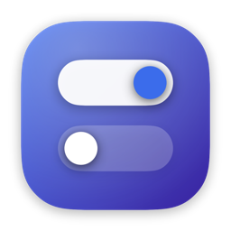
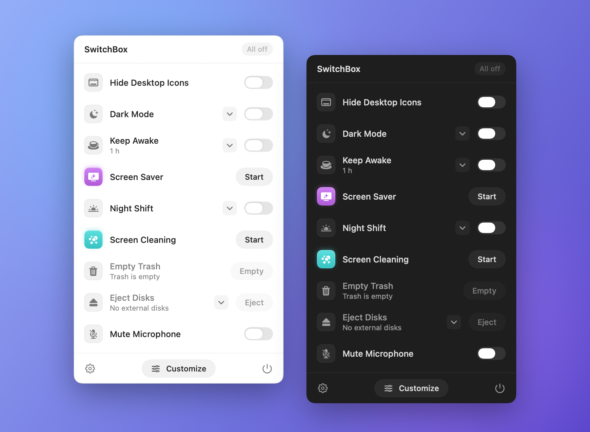
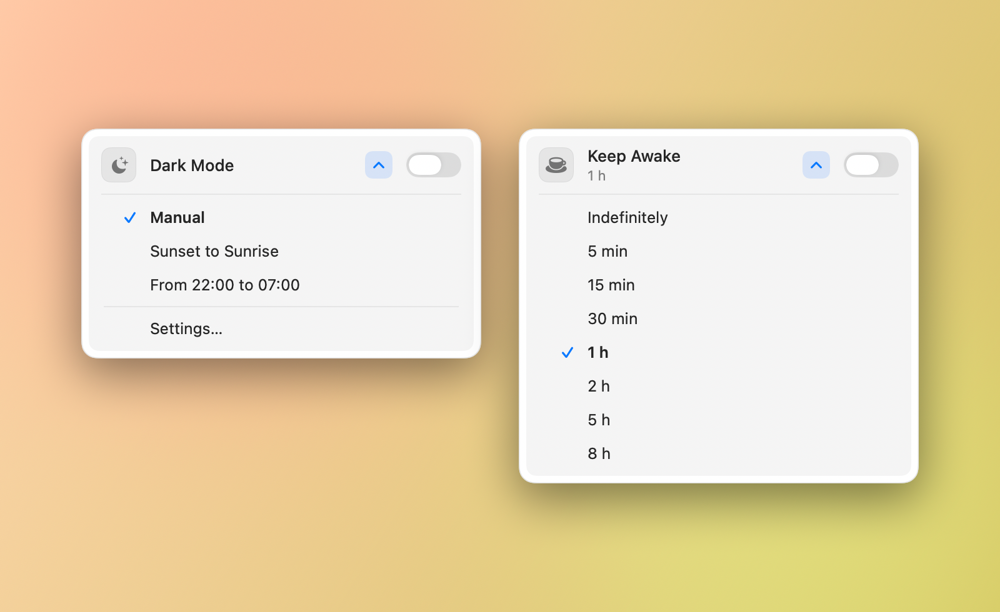
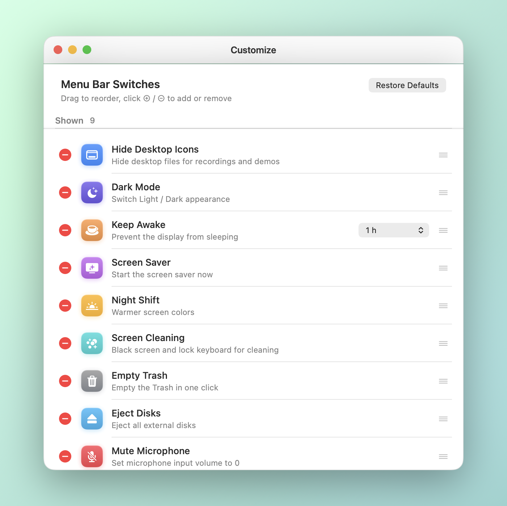
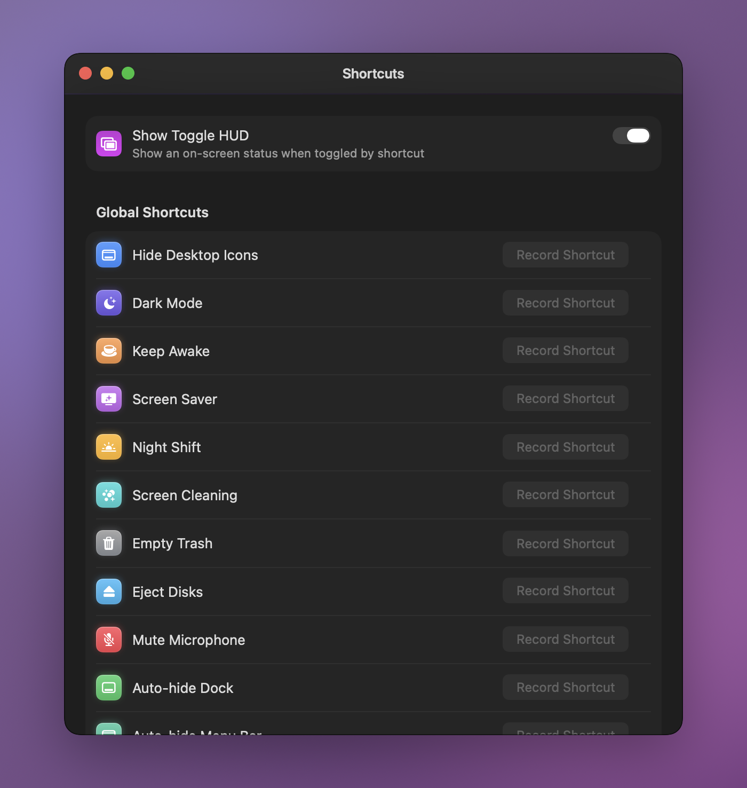
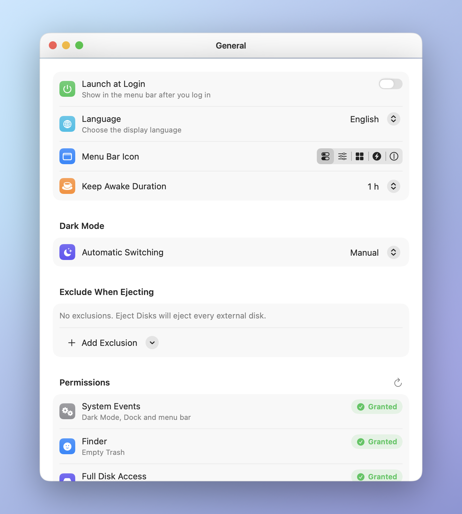

<div align="center">

<a href="README.md"></a>
<a href="README.zh-CN.md"></a>

<br><br>



# SwitchBox

**All your everyday macOS toggles, one click away in the menu bar.**

Hide desktop icons, keep your Mac awake, switch Dark Mode, clean the screen, eject disks and 17 more, right from the menu bar.

<br>

<a href="https://github.com/245678000000/SwitchBox/releases/latest"></a>

<br><br>


<br><br>



</div>

<br>

## Why SwitchBox

<table>
<tr>
<td width="33%" valign="top">

### ⚡️ One click
Toggles that normally take you three levels deep into System Settings, a Terminal command or an AppleScript are now a single switch.

</td>
<td width="33%" valign="top">

### 🪶 Native and light
Pure SwiftUI with no Electron, no background daemons and no analytics. It just lives quietly in your menu bar.

</td>
<td width="33%" valign="top">

### 🎛 Yours to arrange
Choose which switches appear, drag them into your own order and give any of them a global keyboard shortcut.

</td>
</tr>
</table>

<br>

## Smart options, right in the menu

Click the chevron next to a switch to change how it works without opening Settings. Keep your Mac awake for exactly one hour, let Dark Mode follow sunset and sunrise, or put Night Shift on a schedule.

<p align="center">
  
</p>

<br>

## Everything in one place

<table>
<tr>
<td width="50%" valign="top">

#### Toggles

- 🖥 **Hide Desktop Icons**: a clean desktop for demos and recordings
- 🌙 **Dark Mode**: manual, sunset to sunrise, or a custom schedule
- ☕️ **Keep Awake**: 5 min to 8 h, or indefinitely
- 🌅 **Night Shift**: with automatic sunset to sunrise
- 🎨 **True Tone**
- 🔋 **Low Power Mode**
- 🔇 **Mute** and 🎙 **Mute Microphone**
- 📶 **Wi‑Fi** and 🛜 **Bluetooth**
- 🪟 **Hide Windows** of every other app
- ⬇️ **Auto-hide Dock** and ⬆️ **Auto-hide Menu Bar**
- 👁 **Show Hidden Files** in Finder

</td>
<td width="50%" valign="top">

#### One-click actions

- ✨ **Screen Saver**
- 🫧 **Screen Cleaning**: blacks out the screen and locks the keyboard; hold <kbd>esc</kbd> to exit
- 🔒 **Lock Screen**
- 💤 **Display Sleep**
- 🗑 **Empty Trash**, with an item count
- ⏏️ **Eject Disks**, with exclusions such as a Boot Camp partition
- 📋 **Clear Clipboard**
- 🔨 **Clean Xcode Cache**, showing how much space it frees

</td>
</tr>
</table>

<br>

## Make it yours

<table>
<tr>
<td width="50%" align="center" valign="top">
  
  <br><b>Customize</b><br>
  <sub>Add, remove and reorder switches by dragging</sub>
</td>
<td width="50%" align="center" valign="top">
  
  <br><b>Global shortcuts</b><br>
  <sub>A hotkey for every switch, with a system-style HUD</sub>
</td>
</tr>
</table>

<p align="center">
  
  <br><b>General</b><br>
  <sub>Launch at login, language, menu bar icon, schedules, eject exclusions and a live permission center</sub>
</p>

<br>

## Installation

1. Download **SwitchBox-x.y.z.dmg** from the [latest release](https://github.com/245678000000/SwitchBox/releases/latest).
2. Open it and drag **SwitchBox** into **Applications**.
3. Launch it. The icon appears in your menu bar.

> [!NOTE]
> SwitchBox is ad-hoc signed and not yet notarized. If macOS blocks it the first time, right-click the app and choose **Open**, or run:
> ```bash
> xattr -dr com.apple.quarantine /Applications/SwitchBox.app
> ```

**Requirements:** macOS 14 Sonoma or later on Apple silicon.

<details>
<summary><b>Build from source</b></summary>

<br>

You need the Xcode Command Line Tools (`xcode-select --install`). The full Xcode app is not required.

```bash
git clone https://github.com/245678000000/SwitchBox.git
cd SwitchBox
./build.sh
open SwitchBox.app
```

</details>

<br>

## Privacy and permissions

SwitchBox collects nothing and only asks for a permission when you first use a feature that needs it. You can see the live status of each permission, and grant it with one click, in **Settings → General → Permissions**.

| Permission | Used for | |
|---|---|---|
| Automation → System Events | Dark Mode, Dock, menu bar | When used |
| Automation → Finder | Empty Trash | When used |
| Full Disk Access | Showing the item count in the Trash | Optional |
| Location | Sunrise and sunset times for schedules | Optional |

Global shortcuts use the Carbon hotkey API, so SwitchBox **never** needs Accessibility access.

<br>

## Languages

English · Français · 简体中文 · 繁體中文. Switch languages any time in **Settings → General**.

<br>

## FAQ

<details>
<summary><b>Does it work on Intel Macs?</b></summary>
<br>
Release builds are currently Apple silicon only. Building from source on an Intel Mac should work.
</details>

<details>
<summary><b>Why did a permission reset after I updated?</b></summary>
<br>
Because the app is ad-hoc signed, macOS may treat each new build as a different app. Grant the permission again in Settings → General.
</details>

<details>
<summary><b>Night Shift, True Tone or Bluetooth stopped working after a macOS update</b></summary>
<br>
These switches rely on private system frameworks that Apple can change at any time. Please <a href="https://github.com/245678000000/SwitchBox/issues/new">open an issue</a>.
</details>

<details>
<summary><b>For developers: how it works</b></summary>

<br>

| Feature | Implementation |
|---|---|
| Keep Awake | `IOPMAssertionCreateWithName` |
| Night Shift / True Tone | `CoreBrightness` (`CBBlueLightClient`, `CBTrueToneClient`) |
| Dark Mode / Dock / menu bar | AppleScript via System Events |
| Hide Desktop / Hidden Files | `com.apple.finder` defaults, then Finder is relaunched |
| Wi‑Fi | `CoreWLAN` |
| Bluetooth | `IOBluetoothPreferenceSetControllerPowerState` |
| Lock Screen | `SACLockScreenImmediate` |
| Eject Disks | `NSWorkspace.unmountAndEjectDevice(at:)` |
| Schedules | Built-in NOAA sunrise/sunset calculation with `CoreLocation` |
| Global shortcuts | Carbon `RegisterEventHotKey` |
| Launch at login | `SMAppService` |

Developer flags: `--snapshot <dir>` renders every screen, `--showcase <snap> <out> <en|zh>` builds the README images, and `--render-icon <file>` renders the app icon.

</details>

<br>

## Roadmap

- [x] English, French, Simplified and Traditional Chinese
- [x] Dark Mode and Night Shift schedules
- [ ] Signed and notarized builds
- [ ] Universal binary (Intel and Apple silicon)
- [ ] More switches: Stage Manager, Focus, AirPods, display resolution

<br>

<div align="center">

**If SwitchBox saves you a few clicks, a ⭐️ would mean a lot.**

<sub>[Report a bug](https://github.com/245678000000/SwitchBox/issues/new) · [Releases](https://github.com/245678000000/SwitchBox/releases)</sub>

</div>
