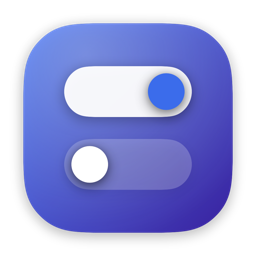
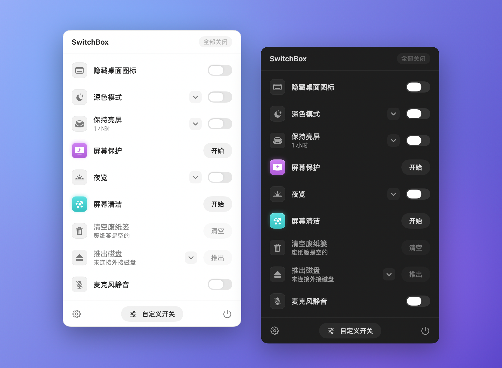
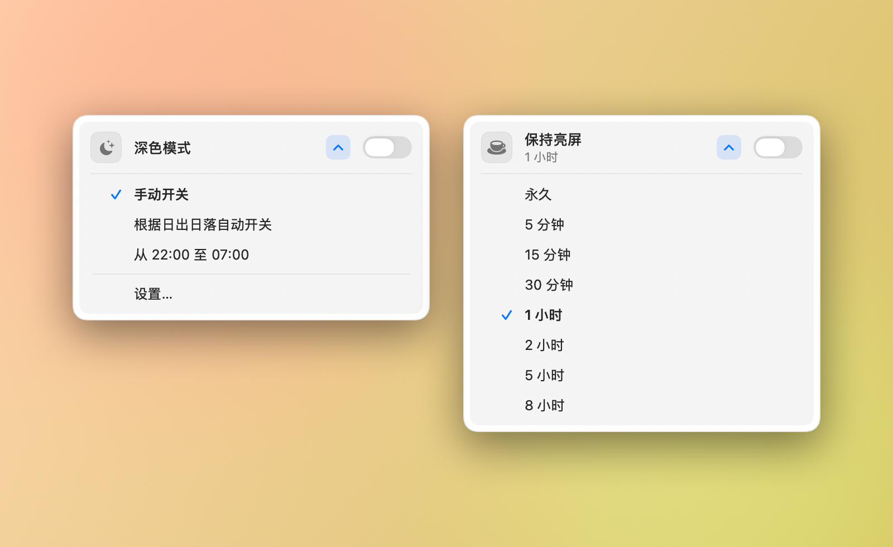
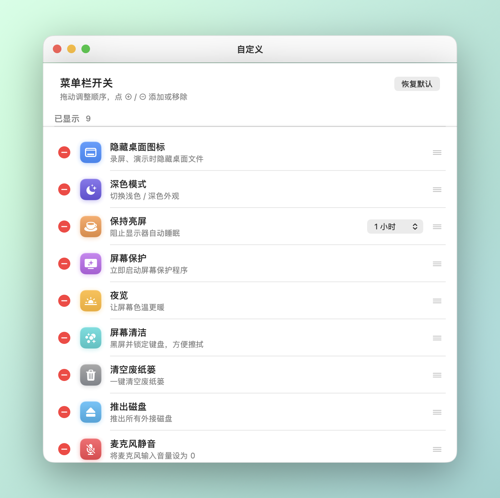
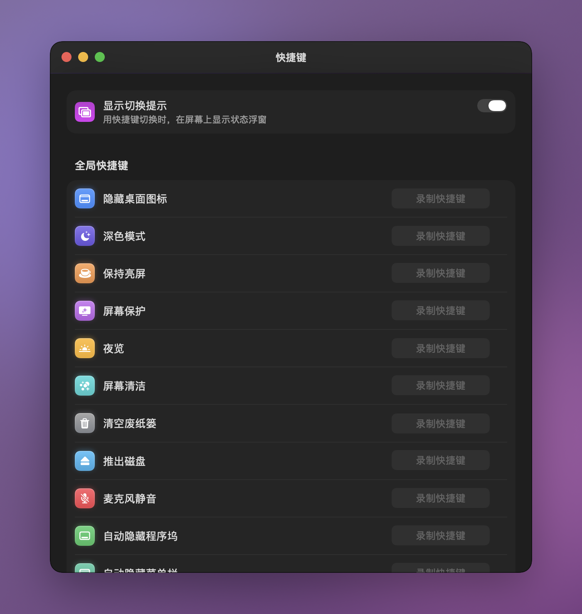
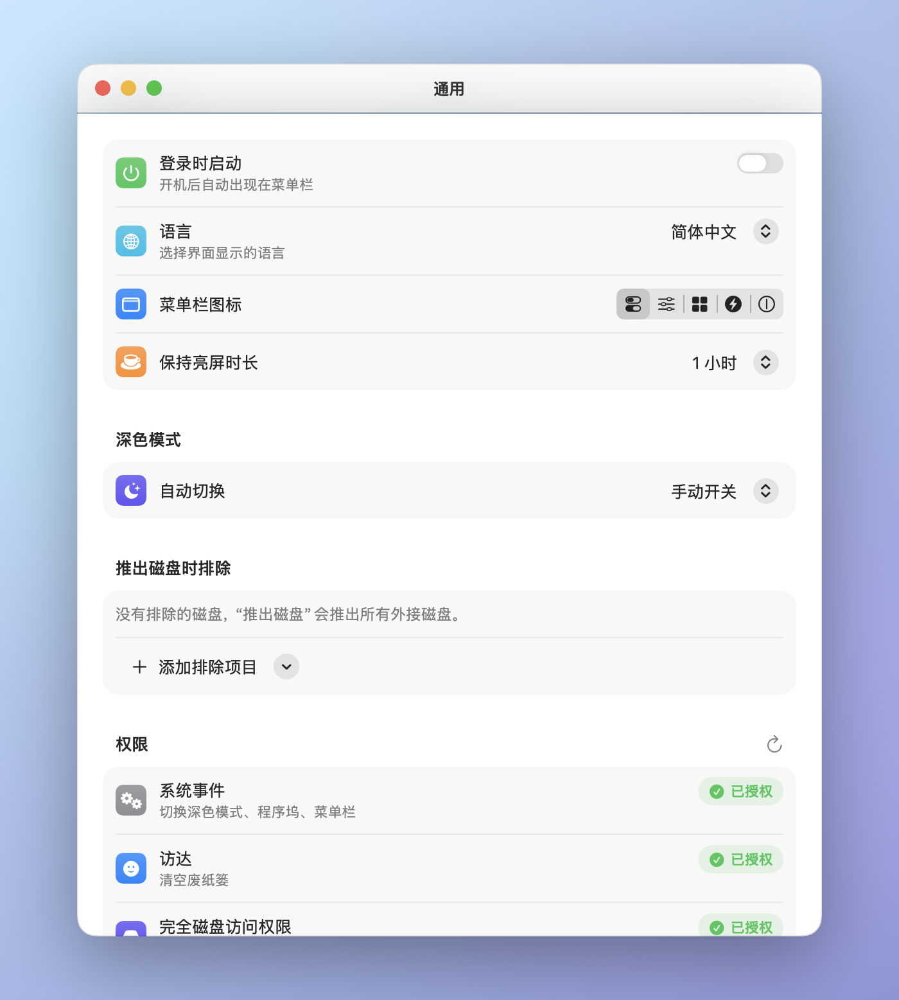

<div align="center">

<a href="README.md"></a>
<a href="README.zh-CN.md"></a>

<br><br>



# SwitchBox

**常用的 macOS 系统开关，都在菜单栏里一键切换。**

隐藏桌面图标、保持亮屏、切换深色模式、清洁屏幕、推出磁盘……22 个开关，点一下就好。

<br>

<a href="https://github.com/245678000000/SwitchBox/releases/latest"></a>

<br><br>


<br><br>



</div>

<br>

## 为什么选 SwitchBox

<table>
<tr>
<td width="33%" valign="top">

### ⚡️ 一键切换
原本要翻好几层系统设置、敲终端命令或写 AppleScript 才能改的东西，现在只是一个开关。

</td>
<td width="33%" valign="top">

### 🪶 原生轻量
纯 SwiftUI 编写。没有 Electron，没有常驻后台进程，也不收集任何数据，安静地待在菜单栏里。

</td>
<td width="33%" valign="top">

### 🎛 随心定制
自己选择显示哪些开关，拖动调整顺序，还能给任意开关设置全局快捷键。

</td>
</tr>
</table>

<br>

## 菜单里直接设置

点开关旁边的箭头，不用打开设置就能调整：保持亮屏 1 小时、深色模式跟随日出日落、夜览按计划自动开关。

<p align="center">
  
</p>

<br>

## 全部功能

<table>
<tr>
<td width="50%" valign="top">

#### 开关

- 🖥 **隐藏桌面图标**：录屏、演示时桌面干干净净
- 🌙 **深色模式**：手动、日落到日出，或自定时间段
- ☕️ **保持亮屏**：5 分钟到 8 小时，或永久
- 🌅 **夜览**：支持根据日出日落自动开关
- 🎨 **原彩显示**
- 🔋 **低电量模式**
- 🔇 **静音** 与 🎙 **麦克风静音**
- 📶 **Wi‑Fi** 与 🛜 **蓝牙**
- 🪟 **隐藏窗口**：一键隐藏其他所有 App
- ⬇️ **自动隐藏程序坞** 与 ⬆️ **自动隐藏菜单栏**
- 👁 **显示隐藏文件**

</td>
<td width="50%" valign="top">

#### 一键操作

- ✨ **屏幕保护**
- 🫧 **屏幕清洁**：屏幕变黑并锁定键盘，长按 <kbd>esc</kbd> 退出
- 🔒 **锁定屏幕**
- 💤 **显示器休眠**
- 🗑 **清空废纸篓**，显示项目数量
- ⏏️ **推出磁盘**，可排除指定磁盘（例如 Boot Camp 分区）
- 📋 **清空剪贴板**
- 🔨 **清理 Xcode 缓存**，显示可释放的空间

</td>
</tr>
</table>

<br>

## 打造你的专属菜单

<table>
<tr>
<td width="50%" align="center" valign="top">
  
  <br><b>自定义</b><br>
  <sub>添加、移除开关，拖动排序</sub>
</td>
<td width="50%" align="center" valign="top">
  
  <br><b>全局快捷键</b><br>
  <sub>每个开关都能设快捷键，切换时弹出系统风格的提示</sub>
</td>
</tr>
</table>

<p align="center">
  
  <br><b>通用</b><br>
  <sub>登录时启动、语言、菜单栏图标、自动计划、推出排除项，以及实时权限中心</sub>
</p>

<br>

## 安装

1. 从 [最新版本](https://github.com/245678000000/SwitchBox/releases/latest) 下载 **SwitchBox-x.y.z.dmg**
2. 打开后把 **SwitchBox** 拖进“应用程序”
3. 启动后，图标会出现在菜单栏

> [!NOTE]
> SwitchBox 目前使用临时签名，还没有经过公证。如果第一次打开被系统拦截，请右键点击应用并选择“打开”，或在终端运行：
> ```bash
> xattr -dr com.apple.quarantine /Applications/SwitchBox.app
> ```

**系统要求：** macOS 14 Sonoma 及以上，Apple 芯片。

<details>
<summary><b>从源码编译</b></summary>

<br>

需要先安装 Xcode 命令行工具（`xcode-select --install`），不需要完整的 Xcode。

```bash
git clone https://github.com/245678000000/SwitchBox.git
cd SwitchBox
./build.sh
open SwitchBox.app
```

</details>

<br>

## 隐私与权限

SwitchBox 不收集任何数据，只有在你第一次用到某个功能时才会请求对应权限。你可以在 **设置 → 通用 → 权限** 里查看每项权限的实时状态，并一键授权。

| 权限 | 用途 | |
|---|---|---|
| 自动化 → 系统事件 | 深色模式、程序坞、菜单栏 | 使用时 |
| 自动化 → 访达 | 清空废纸篓 | 使用时 |
| 完全磁盘访问权限 | 显示废纸篓里的项目数量 | 可选 |
| 定位 | 计算日出日落时间 | 可选 |

全局快捷键使用 Carbon 热键接口，因此**完全不需要**辅助功能权限。

<br>

## 语言

English · Français · 简体中文 · 繁體中文，可以随时在 **设置 → 通用** 中切换。

<br>

## 常见问题

<details>
<summary><b>支持 Intel 芯片的 Mac 吗？</b></summary>
<br>
发布的安装包目前只支持 Apple 芯片。在 Intel Mac 上从源码编译应该可以正常使用。
</details>

<details>
<summary><b>更新后某个权限失效了？</b></summary>
<br>
因为应用是临时签名，macOS 可能会把每个新版本当成不同的应用。到 设置 → 通用 里重新授权即可。
</details>

<details>
<summary><b>系统更新后夜览、原彩显示或蓝牙不工作了</b></summary>
<br>
这几个开关依赖系统私有框架，Apple 随时可能修改。请 <a href="https://github.com/245678000000/SwitchBox/issues/new">提交 Issue</a>。
</details>

<details>
<summary><b>开发者：实现原理</b></summary>

<br>

| 功能 | 实现方式 |
|---|---|
| 保持亮屏 | `IOPMAssertionCreateWithName` |
| 夜览 / 原彩显示 | `CoreBrightness`（`CBBlueLightClient`、`CBTrueToneClient`） |
| 深色模式 / 程序坞 / 菜单栏 | 通过系统事件执行 AppleScript |
| 隐藏桌面 / 显示隐藏文件 | 修改 `com.apple.finder` 偏好设置并重启访达 |
| Wi‑Fi | `CoreWLAN` |
| 蓝牙 | `IOBluetoothPreferenceSetControllerPowerState` |
| 锁定屏幕 | `SACLockScreenImmediate` |
| 推出磁盘 | `NSWorkspace.unmountAndEjectDevice(at:)` |
| 自动计划 | 内置 NOAA 日出日落算法 + `CoreLocation` |
| 全局快捷键 | Carbon `RegisterEventHotKey` |
| 登录时启动 | `SMAppService` |

开发者参数：`--snapshot <目录>` 渲染所有界面截图，`--showcase <截图目录> <输出目录> <en|zh>` 生成 README 配图，`--render-icon <文件>` 渲染应用图标。

</details>

<br>

## 路线图

- [x] 英语、法语、简体中文、繁体中文
- [x] 深色模式与夜览自动计划
- [ ] 签名并公证的安装包
- [ ] 通用二进制（Intel + Apple 芯片）
- [ ] 更多开关：台前调度、专注模式、AirPods、显示器分辨率

<br>

<div align="center">

**如果 SwitchBox 帮你省了几次点击，欢迎点个 ⭐️**

<sub>[反馈问题](https://github.com/245678000000/SwitchBox/issues/new) · [下载历史版本](https://github.com/245678000000/SwitchBox/releases)</sub>

</div>
